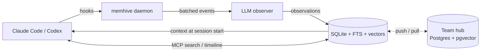
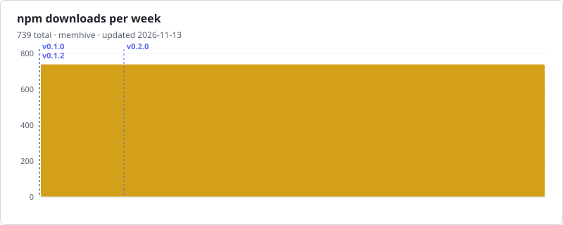

<div align="center">

<h1>memhive</h1>

<p><strong>Long-term memory for coding agents.</strong><br>
Claude Code and Codex remember past sessions: personal by default, shared through a team hub when you want it.</p>

<p>
<a href="https://www.npmjs.com/package/memhive"></a>
<a href="https://npm-stat.com/charts.html?package=memhive"></a>
<a href="https://npm-stat.com/charts.html?package=memhive"></a>
<a href="https://www.npmjs.com/package/memhive?activeTab=code"></a>
</p>

<p>


<a href="./package.json"></a>
</p>

<p>
<a href="https://github.com/trickstarcandina/memhive/actions/workflows/ci.yml"></a>
<a href="https://github.com/trickstarcandina/memhive/actions/workflows/publish.yml"></a>
<a href="./LICENSE"></a>
</p>

<p>
<a href="https://www.npmjs.com/package/memhive"><b>npm</b></a> ·
<a href="https://github.com/trickstarcandina/memhive/pkgs/npm/memhive"><b>GitHub Packages</b></a> ·
<a href="https://github.com/trickstarcandina/memhive/releases"><b>Releases</b></a> ·
<a href="#configuration"><b>Configuration</b></a> ·
<a href="#team-hub"><b>Team hub</b></a> ·
<a href="#troubleshooting"><b>Troubleshooting</b></a>
</p>

</div>

**memhive** watches your Claude Code and Codex sessions, distills what happened into short
observations (decisions, bugfixes, config changes and so on), and feeds the relevant ones back
into the next session. Your agent stops re-learning the same codebase every morning.

## Features

- **Automatic capture**: hooks record prompts and tool use; an LLM turns them into typed observations
- **Context at session start**: recent and relevant memory is injected, within a token budget
- **Hybrid search**: SQLite full-text search plus optional vector search, merged with reciprocal rank fusion
- **MCP tools**: the agent can `search`, browse a `timeline`, fetch full records and `save_memory` itself
- **Any provider**: Anthropic or any OpenAI-compatible endpoint (Ollama, OpenRouter, vLLM, ...) for the observer and embeddings
- **Privacy first**: `<private>` blocks and secrets are stripped before anything is stored; raw tool output never touches disk
- **Team hub**: link a project to a self-hosted hub (Postgres + pgvector) to share memory with your team
- **Local by default**: one SQLite file in `~/.memhive`, no account, no cloud

The project is **pre-1.0**: settings and the hub protocol can still change between minor versions.

## Quick start

Requires **Node.js 22** or newer.

```sh
npm install -g memhive
memhive install
```

`memhive install` asks which hosts to wire up (Claude Code, Codex) and which observer provider to use.
Flags: `--host claude-code,codex`, `--provider anthropic|openai-compat`, `--yes` to skip prompts.

Start a new session in Claude Code or Codex and work as usual. From the second session on, the agent
starts with what it learned before. Check the setup at any time:

```sh
memhive doctor
memhive search "auth middleware"
```

## How it works



- **Hooks.** Claude Code and Codex call `memhive hook <host> <event>` on session start, each prompt, each tool use, stop and session end. Hook commands always exit 0, so they never block the agent.
- **Daemon.** The first hook starts a local daemon (`memhive daemon status|start|stop|run`). It owns the SQLite database (`~/.memhive/memhive.db`) and a per-session event buffer.
- **Observer.** Buffered events are flushed to the LLM after 8 events, after 5 s of idle, or on stop. The LLM turns them into typed observations. A failed LLM call drops its batch; nothing is retried or replayed.
- **Context.** At session start the daemon builds a context block from recent and relevant observations, capped by `MEMHIVE_CONTEXT_TOKENS`, and injects it into the agent.
- **MCP.** `memhive mcp` exposes the memory to the agent in three steps: `search` finds matching observations, `timeline` shows what happened around one, and `get_observations` fetches full records. `save_memory` stores an explicit note.

Observation types: `decision`, `bugfix`, `feature`, `refactor`, `discovery`, `config`, `problem`, `workaround`.

Ids are UUID v7. Anywhere an id is accepted you can pass a unique prefix or the short id, which is the last 8 characters of the id, as shown in CLI output.

## Commands

| Command | Purpose |
| --- | --- |
| `memhive install` / `memhive uninstall` | Wire memhive into Claude Code and Codex, or remove it. Your memory is kept. |
| `memhive search <query> [--type t] [--user u] [--since 7d] [--limit n]` | Search observations from the terminal. |
| `memhive embed [--missing\|--rebuild]` | Compute embeddings for observations. `--rebuild` after changing `MEMHIVE_EMBED_DIMS`. |
| `memhive doctor` | Check settings, provider and embedder credentials, and daemon health. Reports whether each key is set; it never prints keys. |
| `memhive daemon run\|start\|stop\|status` | Control the background daemon. |
| `memhive hook <claude-code\|codex> <event>` | Hook entry point; called by the host, not by you. |
| `memhive mcp` | MCP server over stdio; called by the host. |
| `memhive version` | Print the version. |

## Configuration

Settings live in `~/.memhive/settings.json` (mode 0600). Environment variables override the file and use the same names as the settings keys shown here.

| Variable | Default | Meaning |
| --- | --- | --- |
| `MEMHIVE_HOME` | `~/.memhive` | Data directory (database, settings, daemon info, logs). |
| `MEMHIVE_LLM_PROVIDER` | `anthropic` | Observer provider: `anthropic` or `openai-compat`. |
| `MEMHIVE_ANTHROPIC_API_KEY` | none | Anthropic API key (provider `anthropic`). Required there. |
| `MEMHIVE_ANTHROPIC_MODEL` | `claude-haiku-5-5` | Anthropic model alias. |
| `MEMHIVE_LLM_BASE_URL` | none | OpenAI-compatible endpoint, e.g. `http://localhost:11434/v1`. Required for `openai-compat`. |
| `MEMHIVE_LLM_API_KEY` | none | Key for the OpenAI-compatible endpoint, if it needs one. |
| `MEMHIVE_LLM_MODEL` | `claude-haiku-5-5` | Model name for the OpenAI-compatible endpoint. Set it: the default is an Anthropic model. |
| `MEMHIVE_EMBED_BASE_URL` | none | OpenAI-compatible embeddings endpoint (Ollama, OpenAI, OpenRouter, ...). |
| `MEMHIVE_EMBED_API_KEY` | none | Key for the embeddings endpoint, if needed. |
| `MEMHIVE_EMBED_MODEL` | none | Embedding model name. |
| `MEMHIVE_EMBED_DIMS` | unset | Vector size. Setting it enables vector search; unset means FTS-only search. |
| `MEMHIVE_CONTEXT_TOKENS` | `2000` | Token budget for the injected context block (about 4 characters per token). |
| `MEMHIVE_DEBUG` | unset | Set to `1` or `true` for debug lines in the logs. |

## Privacy

- **`<private>...</private>` is stripped first.** Anything inside these tags is removed from prompts and tool payloads before it is buffered. Nested blocks are handled, and an unclosed tag drops the rest of the text.
- **Secrets are redacted before anything is stored.** Keys and tokens in the usual formats (for example `sk-`, `ghp_`, `AKIA`, `Bearer`, and `password=`/`token=` assignments) are replaced with `<redacted>` in tool payloads, in generated observations and in `save_memory` notes.
- **Images are never stored.** Base64 image data and image content blocks are replaced with a placeholder.
- **Tool events are not written to disk.** Tool inputs and outputs live only in the daemon's memory buffer, capped at 128 events per session and 16 000 characters per field. Only the observations derived from them are saved.
- **Everything stays local** in the default setup. The only outbound calls are to the LLM and embedding endpoints you configure.

## Team hub

A hub shares the observations, summaries and session records of linked projects across a team. Personal memory stays local unless a project is linked.

### Run the hub

The hub is a Node service backed by Postgres with pgvector. The compose stack in `docker/` runs both.

```sh
cd docker
printf 'POSTGRES_PASSWORD=%s\n' "$(openssl rand -hex 24)" > .env   # once; never commit .env
docker compose up -d
docker compose exec hub cat /data/hub-admin-key
```

On first start the hub creates user `admin` and writes its API key to `$MEMHIVE_HOME/hub-admin-key` (mode 0600; `/data/hub-admin-key` in compose). The log shows only the path, so the key does not end up in `docker compose logs`. Read it once, create personal keys (see below), then revoke the initial key with `memhive key revoke <id>` and delete the file. `MEMHIVE_ADMIN_KEY_FILE` changes the path. `MEMHIVE_PRINT_ADMIN_KEY=1` also prints the key on stdout; use it only where stdout is private, because container logs keep it on the host.

The hub speaks plain HTTP on port 7777. A bare `memhive serve` listens on `127.0.0.1` only; set `HOST=0.0.0.0` (the Docker image does) to listen on all interfaces. Put it behind a TLS reverse proxy (Caddy, nginx, a cloud load balancer) that serves `https://hub.example.com` and forwards to the hub. Clients refuse any `http://` hub except `localhost`, `127.0.0.1` and `::1`. Compose publishes the hub on `127.0.0.1:7777` only, so the plain HTTP port is not reachable from the network. The proxy must run on the same host. If it runs elsewhere, change the port mapping in `docker/compose.yml` to a reachable address, and keep the hub behind TLS.

Hub settings are environment variables:

| Variable | Default | Meaning |
| --- | --- | --- |
| `DATABASE_URL` | none (required) | `postgres://…` or `sqlite:<path>`. Compose sets the Postgres URL. |
| `PORT` | `7777` | Listen port. |
| `HOST` | `127.0.0.1` | Listen address. The Docker image sets `0.0.0.0`. |
| `MEMHIVE_EMBED_MODEL` | none | Embedding model the hub expects. Compose sets `bge-m3`. |
| `MEMHIVE_EMBED_DIMS` | unset | Vector size the hub expects. Compose sets `1024`. |
| `MEMHIVE_HUB_BODY_LIMIT` | `2097152` (2 MB) | Maximum request body, in bytes. Pull pages are capped to the same size. |
| `MEMHIVE_RESET_VECTORS` | unset | `1` drops stored vectors when `MEMHIVE_EMBED_DIMS` changed (see below). |
| `MEMHIVE_HOME` | `~/.memhive` | Directory for hub logs and the initial admin key. Compose sets `/data`. |
| `MEMHIVE_ADMIN_KEY_FILE` | `$MEMHIVE_HOME/hub-admin-key` | Where the first start writes the admin key. |
| `MEMHIVE_PRINT_ADMIN_KEY` | unset | `1` also prints the first admin key on stdout. |

`POSTGRES_PASSWORD` is required: compose refuses to start without it. Compose reads it from `docker/.env` and passes it to the hub as `PGPASSWORD`, outside the connection URL, so any characters work.

The hub limits each key to 60 requests per minute. After 30 failed authentications in a minute (all keys together), keys the hub has not seen succeed get `429` with `retry-after` until the minute ends, without a database lookup; keys that authenticated before keep working. For per-client limits, rate-limit at the proxy.

### Add members

Create one key per person or machine. Run these from `docker/`:

```sh
docker compose exec hub node dist/memhive.cjs key create --user alice --label laptop
docker compose exec hub node dist/memhive.cjs key list
docker compose exec hub node dist/memhive.cjs key revoke <id>
```

The new key is printed once and starts with `mh_`. Give it to its owner through a private channel. `key revoke` takes the id shown by `key list`.

### Connect a machine

On each machine, log in once. The command asks for the key without echoing it:

```sh
memhive login https://hub.example.com
```

To script it, pipe the key on stdin. Never pass the key as a command-line argument, because arguments show up in shell history and process listings:

```sh
printf '%s' "$MEMHIVE_KEY" | memhive login https://hub.example.com --key-stdin
```

Then, inside each project you want to share:

```sh
memhive link https://hub.example.com
```

`link` runs an initial pull. `memhive sync` pushes and pulls the current project now. `memhive unlink` stops syncing the current project; its local memory stays.

### What syncs

Observations, summaries and session records of linked projects are pushed to the hub. Prompts and raw tool output never leave the machine, and `<private>` blocks and redacted secrets are removed before anything is stored.

### Embedding model must match

Clients that embed must use the same embedding model and vector size as the hub. Set `MEMHIVE_EMBED_MODEL` and `MEMHIVE_EMBED_DIMS` on the hub to the `embed` model and dims in each client's `~/.memhive/settings.json`. The hub rejects a pushed row whose embedding model differs from its own, or whose vector length differs from `MEMHIVE_EMBED_DIMS`, with `422 embedding_model_mismatch`. Rows without a vector are accepted. `memhive login` warns when the local settings differ from the hub's.

The vector size is fixed when the hub database is created. If `MEMHIVE_EMBED_DIMS` later differs from the database, the hub refuses to start and says so. To switch, start it once with `memhive serve --reset-vectors` (or `MEMHIVE_RESET_VECTORS=1`): this drops every vector stored on the hub (rows stay, and clients keep their local vectors). The flag does nothing when the sizes already match.

Hub-side search is full-text only, because the hub runs no embedder. Client search stays hybrid over local rows, including rows pulled from the hub.

## Troubleshooting

- Run `memhive doctor` first. It checks settings, credentials and daemon health.
- Logs are in `~/.memhive/logs/` (`hook.log`, `daemon.log`, and others). Set `MEMHIVE_DEBUG=1` for more detail.
- If session context is missing, check that `memhive daemon status` reports the daemon running. Hooks start it automatically on the next session.

## Contributing

```sh
git clone https://github.com/trickstarcandina/memhive.git
cd memhive
npm install
npm run typecheck
npm test          # unit and integration tests
npm run build     # bundles dist/memhive.cjs
```

The Postgres hub tests run when `TEST_DATABASE_URL` points to a pgvector database whose name contains `test`.

Releases are published to npm by the [`publish` workflow](./.github/workflows/publish.yml) with
[provenance](https://docs.npmjs.com/generating-provenance-statements): bump `version` in `package.json`
and `src/shared/version.ts`, push, then publish a GitHub release tagged `v<version>`.

## Security

Please report vulnerabilities privately through
[GitHub security advisories](https://github.com/trickstarcandina/memhive/security/advisories/new), not in public issues.

## License

[MIT](./LICENSE)

## Stats

Weekly downloads from npmjs.com, redrawn every day by the [`stats` workflow](./.github/workflows/stats.yml),
with a dashed line for each release. Click the chart for npm-stat's daily breakdown.

<div align="center">

<a href="https://npm-stat.com/charts.html?package=memhive">
  <picture>
    <source media="(prefers-color-scheme: dark)" srcset="https://raw.githubusercontent.com/trickstarcandina/memhive/stats/downloads-dark.svg">
    
  </picture>
</a>

<a href="https://star-history.com/#trickstarcandina/memhive&Date">
  <picture>
    <source media="(prefers-color-scheme: dark)" srcset="https://api.star-history.com/svg?repos=trickstarcandina/memhive&type=Date&theme=dark">
    
  </picture>
</a>

</div>
