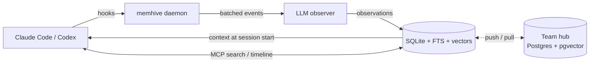

<div align="center">

<h1>memhive</h1>

<p><strong>Long-term memory for coding agents.</strong><br>
Claude Code and Codex remember past sessions: personal by default, shared through a team hub when you want it.</p>

<p>
<a href="https://www.npmjs.com/package/memhive"></a>
<a href="https://npm-stat.com/charts.html?package=memhive"></a>
<a href="https://npm-stat.com/charts.html?package=memhive"></a>
<a href="https://www.npmjs.com/package/memhive?activeTab=code"></a>
</p>

<p>


<a href="./package.json"></a>
</p>

<p>
<a href="https://github.com/trickstarcandina/memhive/actions/workflows/ci.yml"></a>
<a href="https://github.com/trickstarcandina/memhive/actions/workflows/publish.yml"></a>
<a href="./LICENSE"></a>
</p>

<p>
<a href="https://www.npmjs.com/package/memhive"><b>npm</b></a> ·
<a href="https://github.com/trickstarcandina/memhive/pkgs/npm/memhive"><b>GitHub Packages</b></a> ·
<a href="https://github.com/trickstarcandina/memhive/releases"><b>Releases</b></a> ·
<a href="#configuration"><b>Configuration</b></a> ·
<a href="#team-hub"><b>Team hub</b></a> ·
<a href="#troubleshooting"><b>Troubleshooting</b></a> ·
<a href="./docs/ARCHITECTURE.md"><b>Architecture</b></a> ·
<a href="./CHANGELOG.md"><b>Changelog</b></a>
</p>

</div>

**memhive** watches your Claude Code and Codex sessions, distills what happened into short
observations (decisions, bugfixes, config changes and so on), and feeds the relevant ones back
into the next session. Your agent stops re-learning the same codebase every morning.

## Features

- **Automatic capture**: hooks record prompts and tool use; an LLM turns them into typed observations
- **Context at session start**: recent and relevant memory is injected, within a token budget
- **Hybrid search**: SQLite full-text search plus optional vector search, merged with reciprocal rank fusion
- **MCP tools**: the agent can `search`, browse a `timeline`, fetch full records, `save_memory` itself and `pin` / `unpin` what must always be in context
- **Any provider**: Anthropic or any OpenAI-compatible endpoint (Ollama, OpenRouter, vLLM, ...) for the observer and embeddings
- **Privacy first**: `<private>` blocks and secrets are stripped before anything is stored; raw tool output never touches disk
- **Team hub**: link a project to a self-hosted hub (Postgres + pgvector) to share memory with your team
- **Local by default**: one SQLite file in `~/.memhive`, no account, no cloud

The project is **pre-1.0**: settings and the hub protocol can still change between minor versions.

## Quick start

Requires **Node.js 22** or newer.

```sh
npm install -g memhive
memhive install
```

`memhive install` asks which hosts to wire up (Claude Code, Codex) and which observer provider to use.
Flags: `--host claude-code,codex`, `--provider anthropic|openai-compat`, `--yes` to skip prompts.

Start a new session in Claude Code or Codex and work as usual. From the second session on, the agent
starts with what it learned before. Check the setup at any time:

```sh
memhive doctor
memhive search "auth middleware"
```

### First session checklist

1. Work through one session in a git repo and end it normally. The observer writes observations while you work and a summary at stop.
2. Run `memhive search <a word from that session>` in the same repo. It should list what was recorded.
3. Start a second session. It opens with a context block built from the first.

If search finds nothing, look in `~/.memhive/logs/daemon.log` for `observations stored` lines. Errors from the LLM provider (wrong key, wrong model, unreachable endpoint) show up there too, and `memhive doctor` checks the credentials.

## How it works



- **Hooks.** Claude Code and Codex call `memhive hook <host> <event>` on session start, each prompt, each tool use, stop and session end. Hook commands always exit 0, so they never block the agent.
- **Daemon.** The first hook starts a local daemon (`memhive daemon status|start|stop|run`). It owns the SQLite database (`~/.memhive/memhive.db`) and a per-session event buffer.
- **Observer.** Buffered events are flushed to the LLM after 8 events, after 5 s of idle, or on stop. The LLM turns them into typed observations. A failed LLM call drops its batch; nothing is retried or replayed.
- **Context.** At session start the daemon builds a context block, capped by `MEMHIVE_CONTEXT_TOKENS`, and injects it into the agent. Rows are ranked by age (weight halves about every 10 days) and type (decisions and bugfixes first), with boosts for your own rows (x1.5), rows touching files under the working directory (x1.3), rows from the same git branch (x1.2), pinned rows (x3) and rows recorded again by later sessions (up to x1.5). The top 5 of your own rows also show up to 3 facts each; rows pulled from a hub show only their title, and their file lists give no boost.
- **MCP.** `memhive mcp` exposes the memory to the agent in three steps: `search` finds matching observations, `timeline` shows what happened around one, and `get_observations` fetches full records. `save_memory` stores an explicit note.

Observation types: `decision`, `bugfix`, `feature`, `refactor`, `discovery`, `config`, `problem`, `workaround`.

Ids are UUID v7. Anywhere an id is accepted you can pass a unique prefix or the short id, which is the last 8 characters of the id, as shown in CLI output.

## Commands

| Command | Purpose |
| --- | --- |
| `memhive install` / `memhive uninstall` | Wire memhive into Claude Code and Codex, or remove it. Your memory is kept. |
| `memhive search <query> [--type t] [--user u] [--since 7d] [--limit n]` | Search observations and session summaries from the terminal. |
| `memhive embed [--missing\|--rebuild]` | Compute embeddings for observations now. The daemon also backfills on its own (one batch per second while rows are missing) and drops every vector when `embed.model` or `embed.dims` changes. `--rebuild` drops every vector and embeds everything again. |
| `memhive doctor` | Check settings, provider and embedder credentials, and daemon health. Reports whether each key is set; it never prints keys. |
| `memhive daemon run\|start\|stop\|status` | Control the background daemon. |
| `memhive hook <claude-code\|codex> <event>` | Hook entry point; called by the host, not by you. |
| `memhive mcp` | MCP server over stdio; called by the host. |
| `memhive serve` | Run the team hub. Configured by environment variables; see [Team hub](#team-hub). |
| `memhive key create --user <name> [--label <text>]\|list\|revoke <id>` | Manage hub API keys. Run it where the hub's `DATABASE_URL` is set. |
| `memhive login <hub-url> [--key-stdin]` | Store an API key for a hub. Prompts without echo; `--key-stdin` reads the key from stdin. |
| `memhive link <hub-url>` / `memhive unlink` | Start or stop syncing the current project with a hub you are logged in to. |
| `memhive sync` | Push and pull the current project now. |
| `memhive pause [30m\|1h\|2d]` / `memhive resume` | Stop recording for a while (no duration: until `resume`). See [Opting out](#opting-out). |
| `memhive version` | Print the version. |

## Configuration

Settings live in `~/.memhive/settings.json` (mode 0600), which `memhive install` writes. Environment variables override the file. Their names differ from the file's keys, which are nested:

```json
{
  "llm": { "provider": "openai-compat", "model": "qwen2.5:7b", "baseUrl": "http://localhost:11434/v1", "apiKey": "optional" },
  "embed": { "baseUrl": "http://localhost:11434/v1", "model": "bge-m3", "dims": 1024, "apiKey": "optional" },
  "contextTokens": 2000,
  "context": { "scope": "team" },
  "excludeProjects": ["github.com/acme/secret-*", "/home/me/clients/**"],
  "retentionDays": { "default": null, "discovery": 180 },
  "mcp": { "allowProjects": [] }
}
```

`llm.apiKey` holds the key for either provider. `llm.model` applies only to the provider saved next to it: switching provider through `MEMHIVE_LLM_PROVIDER` falls back to that provider's default model. `embed` needs `baseUrl`, `model` and `dims`; leave it out (or `null`) for full-text search only.

| Variable | Default | Meaning |
| --- | --- | --- |
| `MEMHIVE_HOME` | `~/.memhive` | Data directory (database, settings, daemon info, logs). |
| `MEMHIVE_LLM_PROVIDER` | `anthropic` | Observer provider: `anthropic` or `openai-compat`. |
| `MEMHIVE_ANTHROPIC_API_KEY` | none | Anthropic API key (provider `anthropic`, `llm.apiKey`). Required there. |
| `MEMHIVE_ANTHROPIC_MODEL` | `claude-haiku-5-5` | Anthropic model alias (`llm.model`). |
| `MEMHIVE_LLM_BASE_URL` | none | OpenAI-compatible endpoint, e.g. `http://localhost:11434/v1` (`llm.baseUrl`). Required for `openai-compat`. |
| `MEMHIVE_LLM_API_KEY` | none | Key for the OpenAI-compatible endpoint, if it needs one (`llm.apiKey`). |
| `MEMHIVE_LLM_MODEL` | `qwen2.5:7b` | Model name for the OpenAI-compatible endpoint (`llm.model`). |
| `MEMHIVE_EMBED_BASE_URL` | none | OpenAI-compatible embeddings endpoint (Ollama, OpenAI, OpenRouter, ...) (`embed.baseUrl`). |
| `MEMHIVE_EMBED_API_KEY` | none | Key for the embeddings endpoint, if needed (`embed.apiKey`). |
| `MEMHIVE_EMBED_MODEL` | none | Embedding model name (`embed.model`). |
| `MEMHIVE_EMBED_DIMS` | unset | Vector size (`embed.dims`). Setting it enables vector search; unset means FTS-only search. |
| `MEMHIVE_CONTEXT_TOKENS` | `2000` | Token budget for the injected context block (`contextTokens`). A token counts as 4 characters, or 3 for text that is more than 20 % non-ASCII (CJK, Vietnamese). |
| `MEMHIVE_CONTEXT_SCOPE` | `team` | `mine` keeps teammates' pulled rows out of the session-start context; MCP search still finds them (`context.scope`). The older `context.includeOtherUsers: false` / `MEMHIVE_CONTEXT_INCLUDE_OTHER_USERS=0` still work as a deprecated alias for `mine`. |
| `MEMHIVE_EXCLUDE_PROJECTS` | none | Comma-separated project keys or globs that are never recorded (`excludeProjects`). See [Opting out](#opting-out). |
| `MEMHIVE_RETENTION_DAYS` | unset | Days to keep observations of types without their own entry (`retentionDays.default`; unset or `0`: forever). `retentionDays` also takes one entry per type, and `discovery` defaults to 180. Age counts from the last time a row was recorded again. Pinned rows are never removed, and in a linked project only rows already pushed to the hub are. The daemon applies it at start and every 10 minutes. |
| `MEMHIVE_MCP_ALLOW_PROJECTS` | none | Comma-separated project keys or globs the MCP `search` tool may read when the agent passes `project` (`mcp.allowProjects`). Any other key is ignored and the current project is searched, so text in one repo cannot make the agent read another project's memory. |
| `MEMHIVE_DISABLED` | unset | Set to `1` to turn memhive off: hooks exit at once without contacting the daemon, and MCP tools answer "memhive disabled". |
| `MEMHIVE_DEBUG` | unset | Set to `1` or `true` for debug lines in the logs. |

### Opting out

- **Everything, for a while:** `memhive pause 1h` (or `30m`, `2d`; no duration pauses until `memhive resume`). The pause lives in `~/.memhive/state.json`, not in settings, and the daemon notices within 5 seconds. Nothing is recorded and session start injects no context while paused.
- **Everything, for a shell or a CI job:** `MEMHIVE_DISABLED=1`.
- **Some projects, always:** list them in `excludeProjects`. Each entry is a project key or a glob over keys, where `*` matches inside one `/` segment and `**` matches across segments. Entries are also matched against the repo's root directory, which is the only way to exclude a directory without a git remote. The daemon reads settings at start; restart it (`memhive daemon stop`) after a change.
- **One repo, for everyone who clones it:** commit `.memhive.json` with `{ "disabled": true }` at the repo root (or in a subdirectory, for that part of the tree).

An excluded or paused session gets an empty context, and its prompts and tool calls are dropped before they reach the observer. `memhive doctor` says when capture is paused or the current project is excluded. Exclusion is decided when a session starts; a session that is already running keeps going until it ends, unless its project key matches `excludeProjects`.

### Project identity

Memory is grouped by project. The key is the repo's `origin` remote, normalized: scheme, user and `.git` are dropped and the result is lowercased, so `git@github.com:Acme/App.git` and `https://github.com/acme/app` are the same project. Every clone of a repo, on any machine, shares one memory, which is what lets a team hub merge it.

- A directory with no git `origin` gets a local key, `path:` plus a hash of its absolute path. It cannot be shared, and moving the directory starts a new memory.
- Every package of a monorepo shares the repo's memory, and a fork with its own `origin` gets its own.
- A package can have its own memory: commit `.memhive.json` with `{ "project": "github.com/acme/mono/packages/web" }` in the package directory. The nearest `.memhive.json` between the working directory and the repo root applies. The override must start with the repo's own key and a `/`. Any other value is ignored, because a committed file could otherwise point a cloned repo at another project's memory.

## Privacy

- **`<private>...</private>` is stripped first.** Anything inside these tags is removed from prompts and tool payloads before it is buffered. Nested blocks are handled, and an unclosed tag drops the rest of the text.
- **Secrets are redacted before anything is stored.** Keys and tokens in the usual formats (for example `sk-`, `ghp_`, `AKIA`, `Bearer`, and `password=`/`token=` assignments) are replaced with `<redacted>` in tool payloads, in generated observations and in `save_memory` notes.
- **Pulled rows are sanitized again.** Rows pulled from a hub go through the same secret redaction and are clipped to the hub's field caps before they are stored, since another client (or anyone with a key) may have skipped both.
- **Images are never stored.** Base64 image data and image content blocks are replaced with a placeholder.
- **Tool events are not written to disk.** Tool inputs and outputs live only in the daemon's memory buffer, capped at 128 events per session and 16 000 characters per field. Only the observations derived from them are saved.
- **Tool calls are sent to your LLM provider.** To write observations, the daemon sends the prompt (up to 2 000 characters) and each tool call's input and output (up to 4 000 characters each, after the stripping and redaction above) to the observer you configured. With a hosted provider, that is your code and command output leaving the machine. Use a local model through `openai-compat` to keep it on the machine.
- **Cost.** The observer makes one LLM call per flush (8 tool calls, 5 s of idle, or stop) of at most about 17 000 input tokens (8 calls of up to 8 000 characters, at about 4 characters per token) and usually much less, plus one small summary call per turn. Multiply by your provider's price for the model; a small model such as the default keeps it low, and a local model costs nothing.
- **Everything stays local** in the default setup. The only outbound calls are to the LLM and embedding endpoints you configure.

## Team hub

A hub shares the observations, summaries and session records of linked projects across a team. Personal memory stays local unless a project is linked.

### Run the hub

The hub is a Node service backed by Postgres with pgvector. The compose stack in `docker/` runs both.

```sh
cd docker
printf 'POSTGRES_PASSWORD=%s\n' "$(openssl rand -hex 24)" > .env   # once; never commit .env
docker compose up -d
docker compose exec hub cat /data/hub-admin-key
```

On first start the hub creates user `admin` and writes its API key to `$MEMHIVE_HOME/hub-admin-key` (mode 0600; `/data/hub-admin-key` in compose). The log shows only the path, so the key does not end up in `docker compose logs`. Read it once, create personal keys (see below), then revoke the initial key with `memhive key revoke <id>` and delete the file. `MEMHIVE_ADMIN_KEY_FILE` changes the path. `MEMHIVE_PRINT_ADMIN_KEY=1` also prints the key on stdout; use it only where stdout is private, because container logs keep it on the host.

The hub speaks plain HTTP on port 7777. A bare `memhive serve` listens on `127.0.0.1` only; set `HOST=0.0.0.0` (the Docker image does) to listen on all interfaces. Put it behind a TLS reverse proxy (Caddy, nginx, a cloud load balancer) that serves `https://hub.example.com` and forwards to the hub. Clients refuse any `http://` hub except `localhost`, `127.0.0.1` and `::1`. Compose publishes the hub on `127.0.0.1:7777` only, so the plain HTTP port is not reachable from the network. The proxy must run on the same host. If it runs elsewhere, change the port mapping in `docker/compose.yml` to a reachable address, and keep the hub behind TLS.

Hub settings are environment variables:

| Variable | Default | Meaning |
| --- | --- | --- |
| `DATABASE_URL` | none (required) | `postgres://…` or `sqlite:<path>`. Compose sets the Postgres URL. |
| `PORT` | `7777` | Listen port. |
| `MEMHIVE_HOST` / `HOST` | `127.0.0.1` | Listen address; `MEMHIVE_HOST` wins (some shells, such as tcsh, export `HOST` as the hostname). The Docker image sets `HOST=0.0.0.0`. |
| `MEMHIVE_EMBED_MODEL` | none | Embedding model the hub expects. Compose sets `bge-m3`. |
| `MEMHIVE_EMBED_DIMS` | unset | Vector size the hub expects. Compose sets `1024`. |
| `MEMHIVE_HUB_BODY_LIMIT` | `2097152` (2 MB) | Maximum request body, in bytes. Pull pages are capped to the same size. |
| `MEMHIVE_RESET_VECTORS` | unset | `1` drops stored vectors when `MEMHIVE_EMBED_DIMS` changed (see below). |
| `MEMHIVE_TRUST_PROXY` | unset | `1` reads the client address for the auth throttle from `X-Forwarded-For`. |
| `MEMHIVE_HOME` | `~/.memhive` | Directory for hub logs and the initial admin key. Compose sets `/data`. |
| `MEMHIVE_ADMIN_KEY_FILE` | `$MEMHIVE_HOME/hub-admin-key` | Where the first start writes the admin key. |
| `MEMHIVE_PRINT_ADMIN_KEY` | unset | `1` also prints the first admin key on stdout. |

`POSTGRES_PASSWORD` is required: compose refuses to start without it. Compose reads it from `docker/.env` and passes it to the hub as `PGPASSWORD`, outside the connection URL, so any characters work.

The hub limits each key to 60 requests per minute. After 30 failed authentications in a minute from one client address, that client gets `429` with `retry-after` for keys the hub has not seen succeed, until the minute ends, without a database lookup; keys that authenticated before keep working, and other clients are not affected. Behind a reverse proxy every request comes from the proxy's address, so set `MEMHIVE_TRUST_PROXY=1` to take the client address from the last `X-Forwarded-For` entry (the one your proxy appends; with two proxy layers, such as a CDN in front of nginx, that is the outer proxy's address). Set it only when the hub is reachable through that proxy alone, since otherwise clients can forge the header.

### Add members

Create one key per person or machine. Run these from `docker/`:

```sh
docker compose exec hub node dist/memhive.cjs key create --user alice --label laptop
docker compose exec hub node dist/memhive.cjs key list
docker compose exec hub node dist/memhive.cjs key revoke <id>
docker compose exec hub node dist/memhive.cjs key rotate <id|user>
docker compose exec hub node dist/memhive.cjs user list
docker compose exec hub node dist/memhive.cjs user remove <name>
docker compose exec hub node dist/memhive.cjs project list
```

The new key is printed once and starts with `mh_`. Give it to its owner through a private channel. `key revoke` takes the id shown by `key list`. `key rotate` revokes a key and creates its replacement (same user and label) in one step; it takes a key id, or a user name when that user has one active key. `user list` shows each user's active keys, observation count and last activity. `user remove` revokes every key of a user; their rows stay on the hub and remain visible to the team. `project list` shows each project's row counts and last activity. Every admin command takes `--json`. Admin commands need only `DATABASE_URL`: they skip the embedding dims check and never reset vectors.

### Connect a machine

On each machine, log in once. The command asks for the key without echoing it:

```sh
memhive login https://hub.example.com
```

To script it, pipe the key on stdin. Never pass the key as a command-line argument, because arguments show up in shell history and process listings:

```sh
printf '%s' "$MEMHIVE_KEY" | memhive login https://hub.example.com --key-stdin
```

Then, inside each project you want to share:

```sh
memhive link https://hub.example.com
```

`link` runs an initial pull. `memhive sync` pushes and pulls the current project now. `memhive unlink` stops syncing the current project; its local memory stays.

### What syncs

Observations, summaries and session records of linked projects are pushed to the hub. A session record carries the host, the host's session id and its start and end times; the hub drops the session's working directory, so local paths and usernames are not shared. Prompts and raw tool output never leave the machine, and `<private>` blocks and redacted secrets are removed before anything is stored.

### Embedding model must match

Clients that embed must use the same embedding model and vector size as the hub. Set `MEMHIVE_EMBED_MODEL` and `MEMHIVE_EMBED_DIMS` on the hub to the `embed` model and dims in each client's `~/.memhive/settings.json`. The hub rejects a pushed row whose embedding model differs from its own, or whose vector length differs from `MEMHIVE_EMBED_DIMS`, with `422 embedding_model_mismatch`. Rows without a vector are accepted. `memhive login` warns when the local settings differ from the hub's.

The vector size is fixed when the hub database is created. If `MEMHIVE_EMBED_DIMS` later differs from the database, the hub refuses to start and says so. To switch, start it once with `memhive serve --reset-vectors` (or `MEMHIVE_RESET_VECTORS=1`): this drops every vector stored on the hub (rows stay, and clients keep their local vectors). The flag does nothing when the sizes already match.

Hub-side search is full-text only, because the hub runs no embedder. Client search stays hybrid over local rows, including rows pulled from the hub.

## Upgrading

```sh
npm install -g memhive@latest
memhive install
```

Re-run `memhive install` after every upgrade. It rewrites the plugin files with the paths of the new build and stops the running daemon, so the next hook starts the new one.

The hooks call the Node binary that ran `memhive install`, by absolute path. With a Node version manager (nvm, fnm, asdf, Volta), re-run `memhive install` after switching or removing that Node version, or the hooks keep using the old one.

## Uninstall and data removal

```sh
memhive uninstall
npm uninstall -g memhive
```

`memhive uninstall` stops the daemon, removes the plugin from Claude Code and Codex (in Codex it also sets the plugin to `enabled = false` in `config.toml`), and deletes the rendered plugin files in `~/.memhive/marketplace`. It leaves `[features] hooks = true` in Codex's `config.toml`, because other plugins may need it.

Your data stays in `~/.memhive`: the memory database (`memhive.db`), logs, `settings.json` with your LLM and embedding API keys, and `credentials.json` with your hub keys. Delete the folder to remove all of it. Revoke the hub key on the hub (`memhive key revoke <id>`) and rotate the provider keys if the machine is not yours to keep. Rows already pushed to a hub stay on the hub.

## Troubleshooting

- Run `memhive doctor` first. It checks settings, credentials and daemon health.
- Logs are in `~/.memhive/logs/` (`hook.log`, `daemon.log`, and others). Set `MEMHIVE_DEBUG=1` for more detail.
- If session context is missing, check that `memhive daemon status` reports the daemon running. Hooks start it automatically on the next session.

## Contributing

```sh
git clone https://github.com/trickstarcandina/memhive.git
cd memhive
npm ci
npm run typecheck
npm test          # unit and integration tests
npm run build     # bundles dist/memhive.cjs
```

The Postgres hub tests run when `TEST_DATABASE_URL` points to a pgvector database whose name contains `test`.
[CONTRIBUTING.md](./CONTRIBUTING.md) has the full setup, the commit convention and the release steps;
[docs/ARCHITECTURE.md](./docs/ARCHITECTURE.md) explains the components and the hub protocol.

Releases are published to npm by the [`publish` workflow](./.github/workflows/publish.yml) with
[provenance](https://docs.npmjs.com/generating-provenance-statements): bump `version` in `package.json`
(the only place it is written), add the release to [CHANGELOG.md](./CHANGELOG.md), push, then publish a
GitHub release tagged `v<version>`.

## Security

Please report vulnerabilities privately through
[GitHub security advisories](https://github.com/trickstarcandina/memhive/security/advisories/new), not in public issues.
See [SECURITY.md](./SECURITY.md) for supported versions and scope.

## License

[MIT](./LICENSE)

## Stats

Weekly downloads from npmjs.com, redrawn every day by the [`stats` workflow](./.github/workflows/stats.yml),
with a dashed line for each release. Click the chart for npm-stat's daily breakdown.

<div align="center">

<a href="https://npm-stat.com/charts.html?package=memhive">
  <picture>
    <source media="(prefers-color-scheme: dark)" srcset="https://raw.githubusercontent.com/trickstarcandina/memhive/stats/downloads-dark.svg">
    
  </picture>
</a>

<a href="https://star-history.com/#trickstarcandina/memhive&Date">
  <picture>
    <source media="(prefers-color-scheme: dark)" srcset="https://api.star-history.com/svg?repos=trickstarcandina/memhive&type=Date&theme=dark">
    
  </picture>
</a>

</div>
