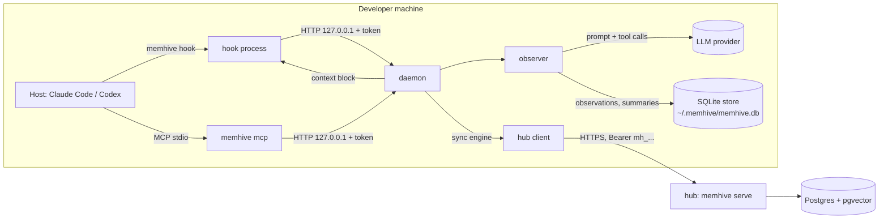

# Architecture

memhive is one Node program (`dist/memhive.cjs`, bundled from `src/` by esbuild) that plays four
roles depending on the subcommand: hook, local daemon, MCP server and team hub. This page describes
how they fit together and the hub's wire protocol. It describes the current release; pre-1.0, the
protocol can change between minor versions.

## Components



| Part | Source | Role |
| --- | --- | --- |
| CLI entry | `src/cli/` | Parses the subcommand and lazy-loads its module, so a hook never loads the hub or MCP code. |
| Hooks | `src/hooks/` | Normalize each host's payload, strip `<private>` blocks and secrets, forward to the daemon. Always exit 0. |
| Daemon | `src/daemon/` | Long-lived local HTTP server on `127.0.0.1`, random port and token in `daemon.json`. Owns the database. |
| Observer | `src/observer/` | Buffers events per session and turns them into observations and summaries with the LLM. |
| Providers | `src/providers/` | Anthropic and OpenAI-compatible chat and embedding clients. |
| Store | `src/store/sqlite/` | SQLite with FTS5 and sqlite-vec; schema in `migrations.ts`. |
| Search | `src/search/` | Full-text and vector results merged by reciprocal rank fusion. |
| Context | `src/context/` | Builds the session-start block within the token budget. |
| MCP | `src/mcp/` | stdio MCP server; `search`, `timeline`, `get_observations`, `save_memory` call the daemon. |
| Sync | `src/sync/` | Push/pull engine and hub HTTP client; hub keys in `credentials.json`. |
| Hub | `src/hub/` | `memhive serve`: HTTP API over a Postgres (or SQLite) hub store. |

## Data flow

1. **Hook.** The host runs `memhive hook <host> <event>` for session start, prompt, tool use, stop
   and session end. The hook reads stdin (size capped), sanitizes it and posts it to the daemon,
   starting the daemon first if none answers. A hook never fails the host: errors go to `hook.log`.
2. **Session start.** The daemon resolves the project (see [Project key](#project-key)) and the
   session. For a linked project it pulls from the hub (bounded by a timeout), then returns a context
   block of recent summaries and observations that the hook prints for the host to inject.
3. **Buffer.** Prompt and tool events go to an in-memory buffer per session (128 events, 16 000
   characters per field). Tool payloads are never written to disk.
4. **Observer.** The buffer is flushed after 8 tool events, 5 s of idle, or stop. One LLM call turns
   the batch into typed observations (input and output are cut to 4 000 characters each in the
   prompt). The reply is parsed and validated; a failed call drops the batch. On stop the observer
   also writes a summary of the turn.
5. **Store.** Observations and summaries are redacted again and inserted into SQLite. With embeddings
   configured, vectors are computed and stored next to them (`memhive embed --missing` backfills).
6. **Push.** Each stored batch schedules a debounced push for a linked project.
7. **MCP.** The agent searches memory in three steps: `search` (compact rows), `timeline` (rows around
   one id), `get_observations` (full records). `save_memory` stores an explicit note.

## Project key

`src/shared/project-key.ts`. The key is the `origin` remote normalized to `host/path`, lowercased,
without scheme, user, port or `.git`. A directory without an `origin` gets `path:<sha256 of the
top-level path, 16 hex>`, which is local by nature. All packages of a monorepo share one key.

## Hub protocol

All routes except `GET /healthz` require `Authorization: Bearer mh_<key>`. The key is checked before
the body is read. Responses are JSON; errors are `{ "error": { "code": "...", "message": "..." } }`.

| Route | Purpose |
| --- | --- |
| `GET /healthz` | `{ ok: true, version }`, no auth. |
| `GET /v1/config` | `{ version, protocol, embedding_model, embedding_dims, body_limit }`. Clients cache it for 10 min. |
| `GET /v1/me` | `{ user }` for the key. `memhive login` uses it to check a key. |
| `POST /v1/sync/push` | Upload rows of one project. |
| `GET /v1/sync/pull` | Download rows of one project after a cursor. |
| `GET /v1/search` | Hub-side full-text search: `project_key`, `q`, `type`, `user`, `since`, `limit` (1-100). |

Limits: 60 requests per minute per key (`429 rate_limited`), request body up to
`MEMHIVE_HUB_BODY_LIMIT` bytes, 2 MB by default (`413 too_large`).

### Push

```jsonc
// POST /v1/sync/push
{
  "projectKey": "github.com/acme/app",
  "projectName": "app",
  "sessions":     [{ "id": "<uuid>", "host": "claude-code", "hostSessionId": "...", "cwd": "...", "startedAt": "<iso>", "endedAt": null }],
  "observations": [{ "id": "<uuid>", "sessionId": "<uuid>", "type": "bugfix", "title": "...", "subtitle": "...",
                     "facts": [], "narrative": "...", "concepts": [], "filesRead": [], "filesModified": [],
                     "createdAt": "<iso>", "embedding": [0.1, ...] | null, "embeddingModel": "bge-m3" | null }],
  "summaries":    [{ "id": "<uuid>", "sessionId": "<uuid>", "request": "...", "learned": "...", "completed": "...",
                     "nextSteps": "...", "createdAt": "<iso>" }],
  "tombstones":   [{ "id": "<uuid>", "tbl": "observation" | "summary" | "session", "deleted_at": "<iso>" }]   // protocol 2
}
// 200
{ "accepted": { "sessions": 1, "observations": 3, "summaries": 1, "tombstones": 1 },   // tombstones: only when sent
  "rejected": [{ "id": "<uuid>", "reason": "embedding_model_mismatch" }] }
```

- The hub creates the project on first push. The user comes from the key and the project from
  `projectKey`: any `userId`/`projectId` in a row is overwritten.
- Sessions are processed first, because observations and summaries reference them.
- Per-row rejection reasons: `invalid_id`, `invalid_row`, `invalid_observation`, `invalid_summary`,
  `invalid_vector`, `embedding_model_mismatch`, `not_owner`, `unknown_session`, `forgotten`. A rejected row does
  not fail the request.
- Ids are lowercased on the wire, so string comparisons (ownership, tombstones) are exact.
- A vector is accepted only when `embeddingModel` equals the hub's `MEMHIVE_EMBED_MODEL` and its length
  equals `MEMHIVE_EMBED_DIMS`. The client resends a mismatched row once without its vector.

**Ownership.** A session belongs to the user and project that first pushed it. A later push of the
same session id by another user or into another project is rejected as `not_owner`; the owner can
update `endedAt` (it only moves forward) and `cwd`. An observation or summary is accepted only under a session the pushing
user owns in that project (`unknown_session` otherwise). Observations and summaries are insert-only:
a known id is skipped, never overwritten.

**Tombstones (protocol 2).** A tombstone deletes a row the pushing user owns in the pushed project
(a session takes its observations and summaries with it). A row of another user or project is
rejected `not_owner`; a row the hub does not have is accepted and ignored. Tombstones are applied
after the rows of the same body. The hub records each tombstone, keyed by (project, table, id), and
logs it in `sync_log`; a later push of a forgotten id into the same table of that project is rejected
`forgotten` (matching is per table: a session tombstone never hides an observation with the same id).
A session tombstone deletes only the pusher's own rows under it. At most 200 tombstones per push
(`400 bad_push` above). A client re-sends every tombstone after a hub reset, and keeps a body's
tombstones queued when the hub refuses the whole body.
Rows are otherwise immutable on the hub: local edits are not synced.

**Protocol.** `/v1/config` reports `protocol` (2 since tombstones). A client refuses to sync with a
hub whose protocol is newer than its own. It sends tombstones only to a hub at protocol 2 or later;
for an older hub (or one whose config is unknown) they stay queued, with one warning per hub.

**Client batching** (`src/sync/engine.ts`). Up to 200 rows per table per request and 20 rounds per
push call, filled up to 75 % of the hub's `body_limit`. On 413 the batch is halved, and a single row
too large with its vector is resent without it. 408, 429 and 5xx back off (30 s doubling to 10 min)
and keep the rows. Rows the hub rejects are marked synced and never retried. 401 marks the hub key
failed until the next `memhive login`.

### Pull

```
GET /v1/sync/pull?project_key=github.com/acme/app&since=<seq>&limit=<1..1000, default 500>
```

```jsonc
{ "sessions": [...], "observations": [...], "summaries": [...], "tombstones": [{ "id", "tbl", "deleted_at" }],
  "next_seq": 1234, "has_more": false, "max_seq": 1234, "epoch": "<hub project id>" }
```

Every accepted row appends an entry to the hub's `sync_log` with a per-hub sequence number (`seq`).
A pull returns the rows logged after `since`, in seq order. The client stores `next_seq` as its cursor
for the project and repeats while `has_more` is true. An unknown project returns empty pages with
`max_seq: 0` and no `epoch`.

**Reset detection.** The hub can lose data (restored from an old backup) or be recreated. The client
detects both:

- `max_seq` is the highest seq of the project. A cursor greater than `max_seq` means the hub went back
  in time.
- `epoch` is the hub's id for the project. A value different from the one stored locally means the
  project was recreated, even if the new hub is already past the client's cursor.

On either, the client resets the project's sync state (cursor to 0, every local row unsynced), pulls
from 0 and pushes its rows again. At most one reset happens per pull call, within the call's deadline.
A hub that sends neither field skips the check.

**Applying rows.** Pulled rows are stored with `origin = 'hub'`. The client never overwrites its own
sessions or rows of another project or user; a pulled session is updated only when its `endedAt` or
`cwd` changed. A pulled vector is kept only when its model and size match the local embedder. A row
that fails to store is logged and skipped, so it cannot stall the cursor.
Tombstones in a page are applied first, scoped to the project being pulled: the row is deleted
locally and its id remembered (never pushed back), so a teammate's stale copy is not pulled in again.

## Hub deployment

`docker/compose.yml` runs the hub image (built from `docker/Dockerfile`) and pgvector. The hub
speaks plain HTTP and is published on `127.0.0.1:7777`; TLS is the job of a reverse proxy. Clients
refuse a plain `http://` hub except on loopback. On first start the hub creates user `admin` and
prints its key once.
